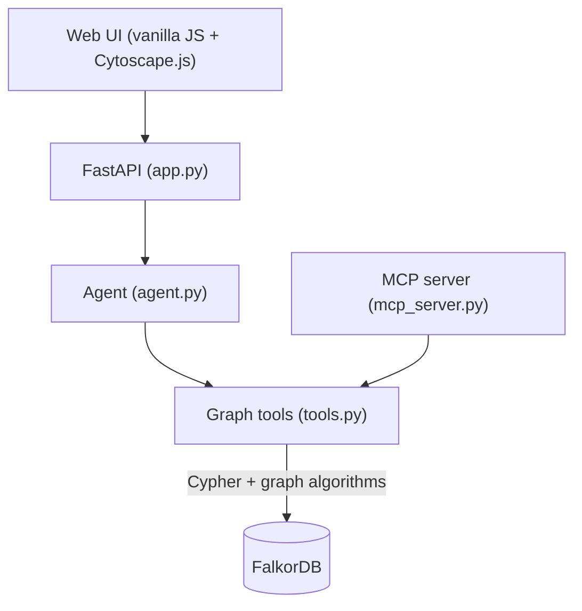

# Fraud Ring Investigator 🕵️

> **Track 01: Agents That Act on Connected Data**
> Graph Hacks: Context for AI Agents (WeMakeDevs × FalkorDB), Oct 2026

An explainable fraud-investigation workbench: select a flagged transfer, trace the surrounding account network in **FalkorDB**, inspect relationship-based evidence, and record a case with the investigation actions. The UI streams each investigation step and visualizes the connected graph.

FalkorDB is central: every investigation step is a graph query or a native graph algorithm, and the actions (freeze, open case) are written back as graph updates. Data is **fully synthetic**.

## What it does
1. Choose one of the three synthetic alerts and click **Investigate**.
2. Watch the investigation stream graph-backed tool steps: linked accounts, communities, hub ranking, shortest transfer path, and circular-flow detection.
3. Review the evidence and the graph highlights, including shared infrastructure and transaction paths.
4. The deterministic demo records the response actions in FalkorDB: account freeze state and a `Case` node linked to investigated accounts.
5. Inspect the final report and the Cypher evidence used to support its findings.

### Demo walkthrough
- Start with **ALERT_003** to see the fan-out hub pattern and multiple mule recipients.
- Try **ALERT_002** to inspect a circular transfer pattern.
- Use **Reset Demo** to restore the seeded graph before recording another run.

All data is synthetic. The planted patterns make the demo reproducible as a walkthrough, not a claim of production-grade fraud detection.

The default mode (**No-LLM**) runs a deterministic pipeline over the same tools, so the demo works without any API key. An LLM mode (Claude or Gemini via API key) is implemented but is optional and lightly tested.

## Architecture


## Graph data model
Three planted rings: **A** (mule chain, shared device), **B** (circular money loop, shared IP), and **C** (hub sending to five mule accounts, shared IP), mixed with 20 low-risk background accounts. Seeded balances and transaction amounts are deterministic; timestamps are relative to the time the graph is seeded.

## Key queries and algorithms (as used in `tools.py`)

**Shortest money path** (evidence trail; `shortestPath` must be in `WITH`/`RETURN` in FalkorDB):
```cypher
MATCH (src:Account {id: $src}), (dst:Account {id: $dst})
WITH shortestPath((src)-[:SENT*]->(dst)) AS p
RETURN [n IN nodes(p) | n.id] AS node_ids, length(p) AS hops
```

**Circular flows** (laundering pattern):
```cypher
MATCH p = (start:Account {id: $acc_id})-[:SENT*2..6]->(start)
RETURN [n IN nodes(p) | n.id] AS cycle_nodes,
       reduce(total = 0.0, rel IN relationships(p) | total + rel.amount) AS total_amount
```

**Ring detection: weakly connected components over shared devices/IPs:**
```cypher
CALL algo.WCC({nodeLabels: ['Account','Device','IP'],
               relationshipTypes: ['USED','LOGGED_FROM']})
YIELD node, componentId
WITH componentId, collect(node.id) AS members, count(node) AS size
WHERE size >= 2
RETURN componentId, members, size ORDER BY size DESC
```

**Hub ranking: PageRank plus transfer degree.** PageRank favors accounts that *receive* money, so degree is added to catch fan-out hubs that *send* to many mules:
```cypher
CALL algo.pageRank('Account', 'SENT') YIELD node, score
MATCH (node)-[r:SENT]-()
RETURN node.id AS account_id, score, count(r) AS degree
ORDER BY degree DESC, score DESC
```

**Shared infrastructure:** multi-hop patterns such as
`(a:Account)-[:USED]->(d:Device)<-[:USED]-(b:Account)`, and the same for `IP` and `Merchant`.

**Actions written back to the graph:** `SET a.frozen = true` and `CREATE (c:Case)` with `(a)-[:FLAGGED_IN]->(c)`.

## Why a graph
Finding rings through shared devices and IPs, tracing multi-hop money paths, and detecting cycles are all pattern problems over relationships. In a relational database each of these typically needs several self-joins or recursive queries; here they are short Cypher patterns plus built-in algorithms (PageRank, WCC, shortestPath).

## Setup (tested on macOS)
Prerequisites: Docker, Python 3.11+.
```bash
# 1. Start FalkorDB
docker run -d --name falkordb_test -p 6379:6379 -p 3000:3000 falkordb/falkordb:latest

# 2. Install dependencies
pip install -r requirements.txt

# 3. Seed the synthetic graph
python3 seed.py

# 4. Start the app
python3 -m uvicorn app:app --port 8000
```
Open **http://localhost:8000**. FalkorDB Browser is at http://localhost:3000. Use **Reset Demo** in the UI to re-seed.

Optional LLM mode: copy `.env.example` to `.env` and add `ANTHROPIC_API_KEY` or `GEMINI_API_KEY`.

## Tests
```bash
python3 -m pytest -q     # requires FalkorDB running and the graph seeded
```
The current suite contains 43 tests covering the six graph tools, the graph data endpoint, and the no-LLM investigation. Run the suite against the same FalkorDB version used for the demo; graph algorithm support can vary by server version.

## MCP server
`mcp_server.py` exposes the same six tools (`linked_accounts`, `trace_path`, `find_circular_flows`, `rank_hubs`, `find_communities`, `take_action`) through the Model Context Protocol. It is implemented but not covered by the automated tests.

## Known limitations
- Docker Compose for the whole app and the Render deployment files are included but untested; use the setup above.
- LLM mode is optional; the verified path is the deterministic no-LLM pipeline.
- Data is synthetic and small (about 34 accounts); this is a demo, not a production system.

## AI tools disclosure
This project was built with AI assistance: **Antigravity (Google Gemini models)** generated the initial scaffold and most files, and **Claude (Anthropic)** helped with planning, debugging, and fixing the graph queries and tests. The author ran, tested, and fixed the project, and is responsible for it.

## Project structure

```text
app.py             FastAPI routes, health check, and investigation stream
agent.py           Deterministic pipeline and optional LLM orchestration
tools.py           FalkorDB Cypher queries, graph algorithms, and graph actions
seed.py            Synthetic graph and three planted fraud patterns
mcp_server.py      MCP exposure for the graph tools
static/index.html  Single-page investigation workbench
 tests/            Automated tool, API, and agent tests
Dockerfile         Container image definition
docker-compose.yml Local app + FalkorDB orchestration
render.yaml        Optional Render deployment configuration
```
